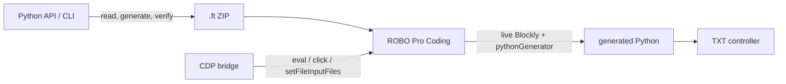

# ROBO Pro Coding Run API Gateway

> An API-style gateway for **fischertechnik ROBO Pro Coding** (`TXT 4.0`) projects.

[](tests/)
[](pyproject.toml)
[](LICENSE)

Read, generate, verify and **drive** Fischertechnik ROBO Pro Coding projects
(`.ft`) — offline from Python, or live through the application itself.

* `.ft` is just a ZIP: JSON metadata + Blockly XML + Python. `ftg` reads and
  writes it without opening the app.
* Block schema for **314 blocks** extracted from the real application
  (`src/ftgateway/data/block-schema.json`), including the Python each block emits.
* A DevTools bridge (`bridge/`) that opens projects inside the running app,
  dumps the live Blockly workspace and asks the app to generate the code.
* A one-command generator for the usual robot programs (motor keeps running,
  LED blink, LED steady, pure-Python projects).

---

## Why this exists

ROBO Pro Coding stores programs as Blockly XML inside a ZIP. That means a
program can be produced, diffed, reviewed and unit-tested like source code —
no clicking required. `ftg` turns that into a small library plus a CLI, and
keeps the nasty details (pin/instance ids, statement-input names, generator
quirks) in one place.

```text
$ ftg gen motor-run --name Motor_Run --speed 512
generated Motor_Run.ft (1899 bytes)
[OK ] container opens
[OK ] metadata complete
[OK ] main program /Motor_Run.blockly exists
[OK ] Motor_Run.blockly: statement inputs match the block schema
RESULT: PASSED
```

## Use it with an AI agent

Clone the repo, then paste one line into your agent (Claude Code, Cursor, Codex, Cline, ...):

> Clone `https://github.com/your-name/robo-pro-coding-run-api-gateway`, read `AGENTS.md`,
> then build my `.ft` programs with `ftg` and verify them.

That is enough. `AGENTS.md` is the contract: container format, commands, the two rules
that silently break projects, and the verification loop the agent must run after every
change. Nothing about the hardware is guessed — the 314-block dictionary in
`src/ftgateway/data/` is the source of truth.

Requirements on the agent's machine:

* Python 3.9+ (no third-party packages)
* optional, only for "open it in the app / screenshot it": Windows + ROBO Pro Coding
  installed (`bridge/launch.ps1`)

If your agent supports skills, install the bundled one so it can be triggered by name
(`fischertechnik-ft`):

```powershell
.\skills\install-skill.ps1              # -> %USERPROFILE%\.claude\skills
```

```bash
./skills/install-skill.sh               # -> ~/.claude/skills
```

Sanity check the agent can run before it starts:

```bash
ftg --version && ftg verify examples/motor-run.ft --strict
```

## Install

```bash
git clone https://github.com/your-name/robo-pro-coding-run-api-gateway.git
cd ftg
pip install -e .          # provides the `ftg` command
# or simply:
PYTHONPATH=src python -m ftg --help
```

No third-party dependencies. Python 3.9+.

## CLI

| command | what it does |
|---|---|
| `ftg info FILE` | structure, metadata, blocks per entry |
| `ftg verify FILE... [--strict]` | offline validation (see below) |
| `ftg gen motor-run\|led-blink\|led-on\|python` | generate a ready-to-run project |
| `ftg new OUT --name N` | empty graphical project |
| `ftg extract FILE OUTDIR` / `ftg pack INDIR OUT` | unpack / repack |
| `ftg get FILE ENTRY` / `ftg put FILE ENTRY SRC` | single-entry edit |
| `ftg config FILE --name N --mode ADVANCED` | metadata (renames main files too) |
| `ftg blocks motor` | search the extracted block catalog |

`ftg verify` checks the container, metadata, the main file matching
`mode`/`name`, XML well-formedness, **statement input names per block**, block
types against the app catalog, and that every `.py` compiles.

## Python API

```python
from ftgateway import build_motor_run, build_led_blink, verify

project = build_motor_run("Motor_Run", speed=512, direction="Motor.CW")
project.save("Motor_Run.ft")
print(verify("Motor_Run.ft", strict=True))

# or build custom block programs
from ftgateway.blocks import ProjectBuilder

builder = ProjectBuilder("Conveyor")
builder.add_motor("M1")
builder.motor("M1", speed=300)
builder.wait(2)
builder.motor("M1", speed=300, direction="Motor.CCW")
builder.wait(2)
builder.motor_off("M1")
builder.build().save("Conveyor.ft")
```

## Bridge (drive the real application)

ROBO Pro Coding is an Electron app. Started with `--remote-debugging-port` it
can be scripted through the Chrome DevTools Protocol: evaluate JS in the
renderer, click, screenshot, and inject project files without any dialog.

```powershell
# Windows: clears the ELECTRON_RUN_AS_NODE trap and picks an isolated profile
.\bridge\launch.ps1 -Port 9334

$env:CDP_PORT = 9334
node bridge\cdp.js list                     # inspect targets
node bridge\cdp.js eval "document.body.innerText"
node bridge\setfile.js examples\motor-run.ft  # opens the project in the app
node bridge\verify_in_app.js ctrl.blockly main.blockly   # parse + generate code
node bridge\dumpblocks.js blocks.json        # refresh the block catalog
```

Why not just click? Because the app's "load project" step ends in an HTML
`<input type=file>`; `DOM.setFileInputFiles` feeds it directly, which removes
the OS dialog from the loop entirely. See [docs/bridge.md](docs/bridge.md).

## Architecture



## The two traps that cost the most time

1. **`loop_endless` uses the statement input `DO`, not `statement`.**
   Any other name makes Blockly silently drop the children — the loop looks
   empty in the UI, with no error. `ftg verify` fails such a file.
2. **Pin instances are `<controller-id>-<pin-block-id>`.** A motor block's
   `instance_name_0` must match the id of the hardware block attached to
   `Motor-0` in `lib/controller.blockly`, or the dropdown falls back to `-`
   and the generated Python becomes `-.set_speed(...)`.

Both are encoded in `src/ftgateway/blocks.py` and checked by `src/ftgateway/verify.py`.

## What is verified, and how

| layer | evidence |
|---|---|
| container / metadata | unit tests, round-trip extract → pack |
| block XML | parsed by the app's own Blockly inside the running process |
| generated Python | produced by the app's `pythonGenerator` (`bridge/verify_in_app.js`) |
| on hardware | motor on M1 keeps turning, LED on M1 blinks (TXT 4.0) |

`src/ftgateway/data/block-catalog.json` and `block-schema.json` are dumps of the
application's own registries — refresh them with `bridge/dumpblocks.js` after
an app upgrade.

## Repository layout

```
src/ftgateway/            library + CLI (project, blocks, verify, cli)
src/ftgateway/data/       block catalog + full schema (extracted from the app)
bridge/             CDP bridge: launch, eval, click, file injection, dumps
docs/               format, bridge, block reference, troubleshooting
examples/           ready-to-open .ft projects
tests/              stdlib unittest suite (13 tests)
```

## Legal

This is an **unofficial** third-party tool. It is not affiliated with,
sponsored by, or endorsed by fischertechnik GmbH or beemo GmbH.

* Code and docs written for this project are MIT licensed ([LICENSE](LICENSE)).
* `src/ftgateway/data/*.json` are interoperability metadata exported from a
  locally installed application (block type ids, input names, field names, and
  the code each block produces). UI wording and generated snippets belong to
  their owners; the MIT license does **not** cover them and grants no
  redistribution right. Details and removal instructions: [NOTICE.md](NOTICE.md).
* No application binaries, installers, firmware, assets, fonts or language packs
  are included.
* Product names and trademarks belong to their respective owners and are used
  only descriptively to state compatibility.
* You drive your own application and projects at your own risk — back up your
  `.ft` files before using the bridge.

## Limitations

* Windows-focused bridge (the app is Electron; the CLI side is portable).
* Upload/run on the TXT controller is still a manual click in the app.
* `block-schema.json` is a snapshot of ROBO Pro Coding 6.5.x — regenerate after
  upgrades.
* Not affiliated with fischertechnik; use on your own hardware.

## Roadmap

- [ ] `ftg upload` — push and run through the app's own upload path
- [ ] Python AST → block translator (schema-driven, currently recipes only)
- [ ] Fixture-based CI: verify `examples/*.ft` on every push
- [ ] Sensor blocks (mini switch, ultrasonic, colour) recipes

## License

MIT — see [LICENSE](LICENSE).

中文说明：[README.zh-CN.md](README.zh-CN.md)
